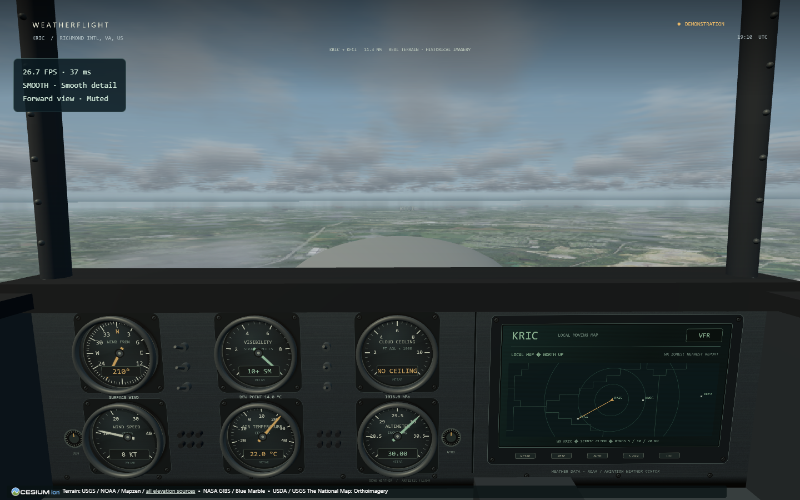

# Weatherflight — Your desktop. Your next flight.

Turn your idle screen into a cockpit. **Weatherflight** is a free aviation screensaver for Windows 11 from [The Thrifty Pilot](https://www.thethriftypilot.com/aviation-software), combining METAR-driven weather, real-world terrain imagery, and available live aircraft traffic.

Choose your departure and destination, then watch weather updates follow your simulated flight.



*Actual application screenshot. Scenery, weather, traffic availability, and performance vary.*

## Download

**[Download Weatherflight for Windows 11](https://github.com/thethriftypilot/Weatherflight/releases/download/v1.8.0-beta.2/Weatherflight-1.8.0-beta.2-Windows-x64.zip)** · [All releases](https://github.com/thethriftypilot/Weatherflight/releases)

**Testing status: public beta.** The current download is tagged `v1.8.0-beta.2`. It has received limited Windows 11 testing and is not yet broadly validated across different graphics cards or multi-monitor configurations. Please report problems and suggestions through Issues.

## New in 1.8.0-beta.2

Watch a complete flight: line up, accelerate, rotate, climb, approach, flare, touch down, and roll to a stop before the arrival journal and next route. Enable **Runway takeoffs and landings** in Route & settings, with real scenery enabled. Both airports need recorded runway endpoints; unsupported routes retain the airborne experience. Runway selection and approaches are decorative and do not model real operational procedures.

## Features

- METAR-driven weather that follows the simulated aircraft and nearby reporting stations.
- Configurable departure and destination airports, favorite routes, and a flight playlist.
- Real-world terrain imagery, nighttime scenery, and available nearby live aircraft traffic.
- Detailed cockpit instruments, an optional yoke, adjustable seating, and restrained pilot glances.
- Gentle banking, scenic climbs, descents and flyovers, plus optional cinematic exterior views.
- Synchronized panoramic multi-monitor views.
- Quality, Balanced, and Smooth performance presets with a frame-rate display.
- Optional engine, wind, and rain audio, muted by default.

## Requirements and installation

Windows 11 (64-bit), Microsoft Edge WebView2 Runtime, .NET Framework 4.8, and a graphics driver supporting WebGL 2 are required. Internet access is required for online scenery, METAR updates, and traffic. Multi-monitor performance depends on your hardware.

1. Download `Weatherflight-1.8.0-beta.2-Windows-x64.zip` from the release assets.
2. Verify its SHA-256 checksum using the instructions below.
3. Extract the entire ZIP into a folder.
4. Open the extracted folder containing `Install.cmd` and run it.
5. In Windows Screen Saver Settings, select your wait time and click **Apply**. Use **Settings** to customize your flight.

The installer copies the application into your user profile. Keep the package files together; the `.scr` file depends on the included application files. `Preview.cmd` opens a windowed preview.

This build is not Authenticode-signed. A checksum verifies file integrity; it does not establish publisher identity.

## Verify your download

In PowerShell, from the folder containing the ZIP, run:

```powershell
Get-FileHash -LiteralPath .\Weatherflight-1.8.0-beta.2-Windows-x64.zip -Algorithm SHA256
```

For the `v1.8.0-beta.2` ZIP, the expected SHA-256 is:

```text
385cad1ad946babe65bbd2712f7b1a5bea5c02d82112e6cde5b8952e6722c4ee
```

Compare all 64 characters, ignoring letter case. Do not install a file whose checksum does not match. A machine-readable manifest is included in this repository as [SHA256SUMS.txt](SHA256SUMS.txt).

## Bugs and feature requests

**[Report a bug or suggest a feature](https://github.com/thethriftypilot/Weatherflight/issues)**

For bugs, include the download version, Windows version, graphics card, number and resolution of monitors, performance preset, route, steps to reproduce, and what happened. Screenshots are helpful; remove personal information before posting.

## Support development

Weatherflight is free. Donations are optional and are never required to download or use it. If you would like to help with coffee and further software development for pilots, visit [The Thrifty Pilot's Aviation Software page](https://www.thethriftypilot.com/aviation-software) and use its separate PayPal support button.

## Important limitations

**For entertainment, not navigation, flight planning, or operational decision-making.** Surface METAR observations approximate airborne conditions. Imagery may be historical; weather and traffic can be delayed, unavailable, or incomplete. Scenic flight behavior is a visual simulation. Data-source attributions are included with the application.

